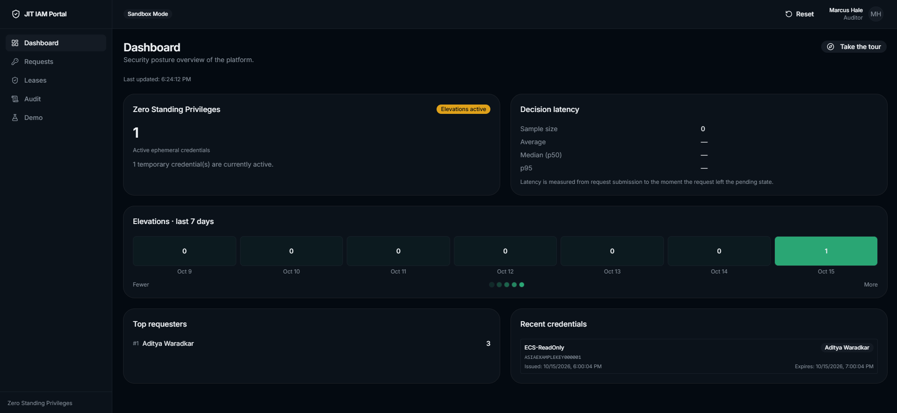
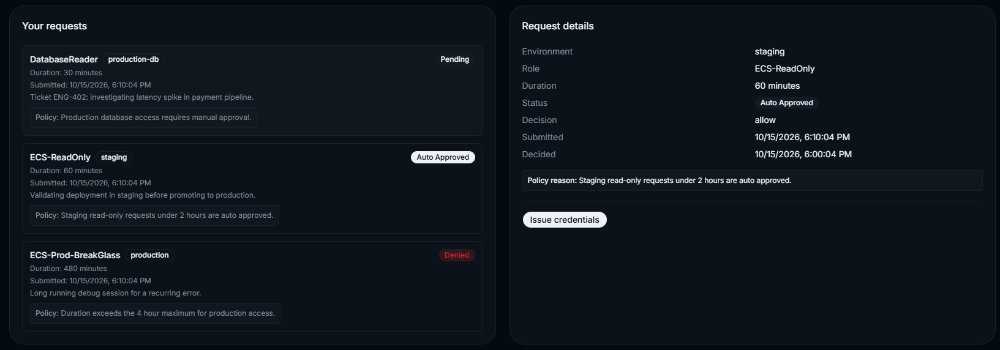
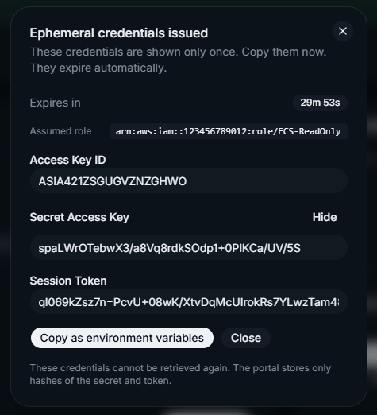
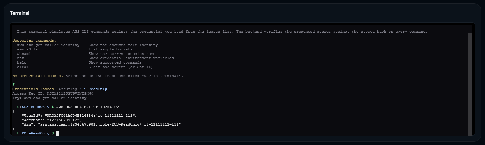
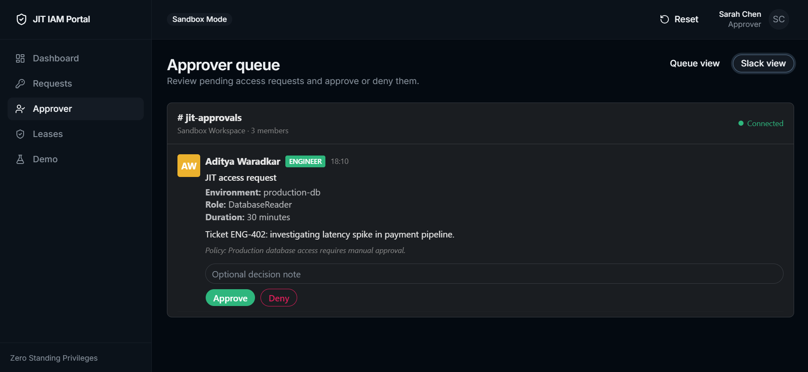
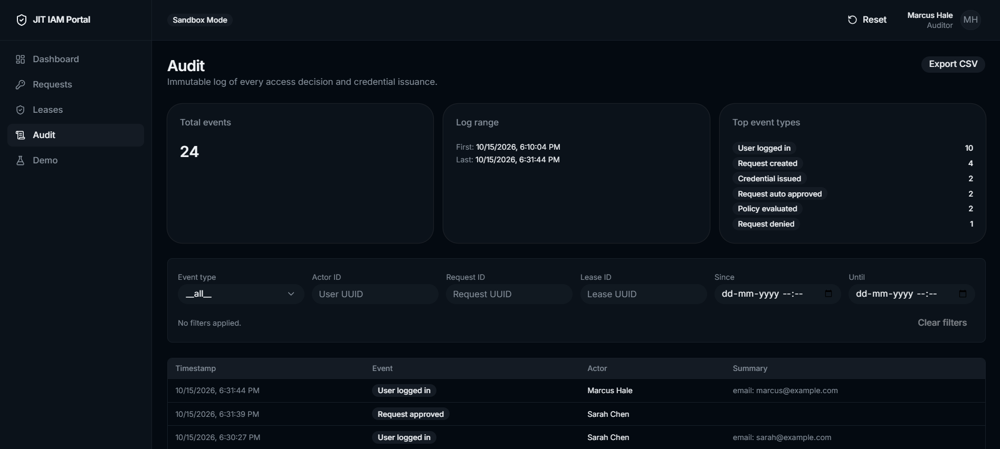
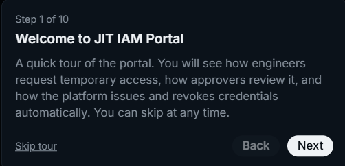

# JIT IAM Portal

**Zero Trust Ephemeral Access and Just In Time Cloud IAM Portal**

Eliminate static credentials. Enforce Zero Standing Privileges. Grant access only when needed, and revoke it automatically.

[](https://github.com/adityawaradkar/jit-iam-portal/actions/workflows/ci.yml)
[](https://github.com/adityawaradkar/jit-iam-portal/actions/workflows/security.yml)
[](./LICENSE)

[Architecture](./docs/architecture.md) · [Deployment](./docs/deployment.md) · [Security Policy](./SECURITY.md) · [Contributing](./CONTRIBUTING.md)

---



---

## Overview

**JIT IAM Portal** is a production grade reference implementation of a Zero Trust, Just In Time access management system for cloud infrastructure.

Static, long lived credentials such as permanent AWS IAM keys or hardcoded database passwords remain one of the largest attack vectors in modern cloud environments. A single compromised laptop or an accidentally committed secret can grant an attacker persistent access to production systems.

This project enforces a strict **Zero Standing Privileges** posture. No user holds permanent elevated access. When a legitimate operational need arises, the engineer requests temporary, policy gated permissions through a self service portal. The system evaluates the request against corporate security policy, routes it through an approval workflow, issues short lived credentials via HashiCorp Vault and AWS STS, and revokes them automatically once the TTL expires.

A public interactive sandbox lets reviewers experience the full workflow live without requiring an AWS account.

---

## Key Features

- **Zero Standing Privileges**: no permanent elevated credentials exist
- **Just In Time Access**: request, approve, use, auto revoke
- **Policy as Code**: authorization logic in Open Policy Agent (Rego)
- **Ephemeral Credentials**: mock Vault and STS engine producing realistic ASIA prefixed AWS credentials
- **Approval Workflows**: queue view plus a Slack style interactive simulator
- **Immutable Audit Trail**: every lifecycle event written to the database and mirrored to a JSONL file
- **In Browser Terminal**: simulated AWS CLI commands that verify credentials against stored hashes
- **Security Dashboard**: ZSP status, elevation heatmap, top requesters, decision latency
- **Guided Tour**: a nine step walkthrough of the entire lifecycle
- **Infrastructure as Code**: Terraform modules for VPC, ECS Fargate, RDS, ElastiCache, S3 with Object Lock, IAM, and ALB

---

## Architecture

```
                    ┌───────────────────────────────┐
                    │  Web Visitor / Hiring Manager │
                    └───────────────┬───────────────┘
                                    │ HTTPS
                                    ▼
                    ┌───────────────────────────────┐
                    │   Next.js Self Service Portal │
                    └───────────────┬───────────────┘
                                    │ REST
                                    ▼
                    ┌───────────────────────────────┐
                    │     FastAPI Orchestrator      │
                    └───┬───────────┬───────────┬───┘
                        │           │           │
                        ▼           ▼           ▼
                  ┌─────────┐ ┌──────────┐ ┌─────────────┐
                  │   OPA   │ │  Slack   │ │   Vault /   │
                  │ (Rego)  │ │Simulator │ │  AWS STS    │
                  └─────────┘ └──────────┘ └──────┬──────┘
                                                  │
                                                  ▼
                                          ┌───────────────┐
                                          │  S3 + Audit   │
                                          └───────────────┘
```

Full component breakdown: [`docs/architecture.md`](./docs/architecture.md).

---

## Screenshots

### Requests and credential issuance



### Ephemeral credentials



### Terminal simulator



### Approver Slack view



### Compliance audit viewer



### Guided tour



---

## Technology Stack

| Layer | Technologies |
|---|---|
| Frontend | Next.js, TypeScript, Tailwind CSS, Shadcn UI, xterm.js |
| Backend | Python, FastAPI, SQLAlchemy, Alembic, structlog |
| Policy Engine | Open Policy Agent (Rego) |
| Secrets Broker | HashiCorp Vault (mock), AWS STS (mock) |
| Data Stores | PostgreSQL, Redis |
| Infrastructure | AWS ECS Fargate, RDS, ElastiCache, S3 with Object Lock, ALB, provisioned with Terraform |
| CI/CD | GitHub Actions, Gitleaks, Trivy, Checkov, Bandit |

---

## Getting Started

### Prerequisites

- Docker and Docker Compose
- Node.js 20 or newer for local frontend development
- Python 3.12 or newer for local backend development

### Running Locally

```
git clone https://github.com/adityawaradkar/jit-iam-portal.git
cd jit-iam-portal
cp .env.example .env
docker compose --profile full up --build
```

Once running:

- Frontend: http://localhost:3000
- API documentation: http://localhost:8000/docs
- OPA health: http://localhost:8181/health

### Trying the Demo

The portal provides three personas. Each demonstrates a different role in the workflow.

1. Log in as **Aditya Waradkar (engineer)** and submit a staging request. It auto approves.
2. Click the request, issue credentials, and copy the ephemeral AWS keys.
3. Navigate to **Leases** and load the credential into the terminal.
4. Run `aws sts get-caller-identity` to see the assumed role.
5. Log out and log in as **Sarah Chen (approver)**. Approve a pending production request in the Slack view.
6. Log out and log in as **Marcus Hale (auditor)**. Explore the audit trail and the security dashboard.

Or click **Take the tour** on the dashboard for a guided walkthrough.

### Common Commands

```
docker compose --profile full up --build    # start the full stack
docker compose --profile full up -d         # start in the background
docker compose logs -f backend              # follow backend logs
docker compose exec backend bash            # shell into the backend
docker compose down                         # stop the stack
docker compose down -v                      # stop and wipe volumes
```

---

## Deploying to AWS

The project includes a complete Terraform configuration under `infra/terraform/`. See [`docs/deployment.md`](./docs/deployment.md) for prerequisites, cost, and step by step instructions.

The configuration is provided as a production reference. It is not required to run the project locally.

---

## Compliance Mapping

| Framework | Control | How This Project Satisfies It |
|---|---|---|
| SOC 2 Type II | CC6.1 Logical Access Controls | Enforces ZSP; all elevation requires authorization |
| ISO 27001 | A.9.2.3 Management of Privileged Access | Automates grant and revocation via JIT |
| NIST SP 800-53 | AC-2 Account Management | Temporary credentials with mandatory expiration |
| PCI-DSS 4.0 | Requirement 7 | Access scoped to justified operational windows |

---

## Roadmap

All sections are complete.

- [x] Section 1: Repository scaffolding
- [x] Section 2: FastAPI backend skeleton
- [x] Section 3: Next.js frontend skeleton
- [x] Section 4: Docker Compose local stack
- [x] Section 5: Database schema and seed data
- [x] Section 6: Persona authentication
- [x] Section 7: Access request API and form
- [x] Section 8: Open Policy Agent integration
- [x] Section 9: Request lifecycle state machine
- [x] Section 10: Dashboard with live metrics
- [x] Section 11: Approver queue
- [x] Section 12: Ephemeral credential issuance
- [x] Section 13: Mock Vault and STS engine
- [x] Section 14: Leases view with live countdown
- [x] Section 15: Background lease expiry worker
- [x] Section 16: Embedded terminal simulator
- [x] Section 17: Slack approval simulator
- [x] Section 18: Audit event pipeline
- [x] Section 19: Compliance audit viewer
- [x] Section 20: Security dashboard
- [x] Section 21: Guided interactive tour
- [x] Section 22: Demo polish and persona experience
- [x] Section 23: Terraform infrastructure as code
- [x] Section 24: CI/CD and final polish

---

## Contributing

See [`CONTRIBUTING.md`](./CONTRIBUTING.md).

## Security

Please read [`SECURITY.md`](./SECURITY.md) before reporting vulnerabilities.

## License

Released under the MIT License. See [`LICENSE`](./LICENSE).

## Author

**Aditya Waradkar**

- GitHub: [@adityawaradkar](https://github.com/adityawaradkar)
- Portfolio: [adityawaradkar-gamma.vercel.app](https://adityawaradkar-gamma.vercel.app/)
- LinkedIn: [in/aditya-waradkar](https://www.linkedin.com/in/aditya-waradkar-9a03b92a5/)
